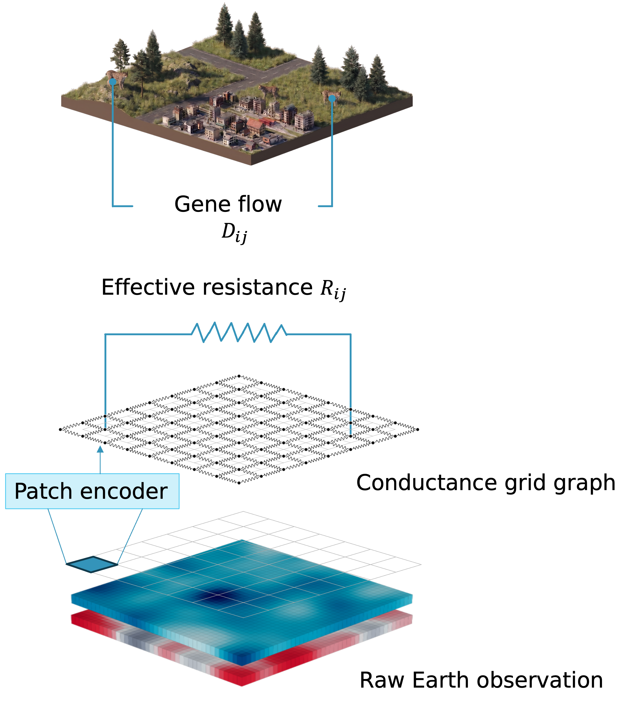

# Deep inverse landscape genetics



This repository exposes a [JAX](https://docs.jax.dev/en/latest/)-based pipeline for *inverse landscape genetics*. It heavily relies on [JAXScape](https://github.com/vboussange/jaxscape), which implements a GPU-accelerated, differentiable resistance layer. This allows learning deep geospatial encoders mapping Earth-observation data to a *conductance* surface characterising how the landscape influences the gene flow of spatially structured ecological populations from genetic data. The pipeline in this repo trains a deep encoder by matching the effective resistance on the induced grid graph to an empirical genetic dissimilarity matrix.

This is a companion repository for the paper

> V. Boussange, P. Thiran, F. Missillier, and G. Dalle. *Learning Spatial Ecological Networks from Geolocated Molecular and Earth Observation Data*. 2026.

## Installation

This directory is a self-contained Python project. Run the commands below from
this directory.

```bash
uv sync --locked            # append --extra gpu on Linux/x86-64 with CUDA
uv run deepilg --help
JAX_ENABLE_X64=true uv run pytest
```

The locked GPU extra pins cuDNN 9.8.0.87 for compatibility with the manuscript
V100/driver-535 cluster. The conductance models (ResNet9 and log-linear) keep
their parameters in float32 but solve effective resistance in float64 for
numerical stability. Enable JAX float64 on their training and evaluation commands:

```bash
JAX_ENABLE_X64=true uv run deepilg train --config configs/demo.toml --model resnet9 --fold 0
```

AMG preconditioning and differentiable linear solves are provided by
JAXScape 0.0.10 with its AMJax extra; DeepILG does not maintain a separate solver
implementation. The configured tolerances and iteration limit apply with or
without AMG.

## Quick start

```bash
uv run deepilg validate   --config configs/demo.toml
uv run deepilg download   --config configs/demo.toml
uv run deepilg preprocess --config configs/demo.toml
JAX_ENABLE_X64=true uv run deepilg train    --config configs/demo.toml --model resnet9 --fold 0
JAX_ENABLE_X64=true uv run deepilg evaluate --config configs/demo.toml --model resnet9 --fold 0
```

`configs/demo.toml` contains default configuration settings to run the whole pipeline on a synthetic dataset. Its outputs carry no ecological meaning; files land under `cache/demo/` and `outputs/demo/`.

## The inverse landscape genetics pipeline in brief

A dataset is organised into geographic *regions* — spatially distinct landscapes, each with its own sampled populations. The pipeline consumes two inputs per region: *labels* — one pairwise genetic-dissimilarity matrix (e.g., Fixation index $F_{ST}$) between the sampled populations — and *features* — geospatial covariates over the landscape together with the population coordinates that locate them on the raster. The commands below turn these into a fitted encoder and its held-out scores.

| Command | Role |
| --- | --- |
| `validate` | Check that the genetic, coordinate, and fold inputs align. |
| `folds` | Draw the population-holdout folds from the genetic data and a seed. |
| `download` | Fetch the public geospatial covariates per region. |
| `preprocess` | Align covariates on a common grid and build the raster inputs. |
| `train` | Fit one model for one population-holdout fold; add `--resume` to continue. |
| `evaluate` | Score saved fits on held-out test pairs and export tidy predictions. |
| `figures` | Report every evaluated model and render the fold and resistance-surface figures. |
| `resistancega-export`, `resistancega` | Export inputs for, and run, the ResistanceGA2 baseline. |

Training minimises the objective `region_balanced_log1p_mse` (`loss.py`), which weights regions equally, under population-holdout cross-validation. Models are selectable with `--model`, all evaluated on identical folds, pairs, and metrics:

- **`resnet9`** — the *deep patch encoder*, the conductance model of interest: a ResNet9 predicts a positive conductance per landscape patch, then effective resistances between populations.
- **`loglinear`** — a low-capacity, radish-inspired conductance encoder: averages the same raster patches, then uses one intercept, 11 land-cover contrasts with tree cover as reference, and two continuous coefficients (14 parameters), with the same bounded exponential head and resistance solver as ResNet9. Its uniform-conductance starting scale is calibrated on training pairs only.
- **`unet`** — an *embedding-distance* model: predicts a patch embedding per node and compares populations by squared Euclidean distance, with no resistance layer.
- **`reference`** — the *isolation-by-distance (IBD) model*: a calibrated non-negative affine function of geographic distance.
- **`resistancega`** — the classical [ResistanceGA2](#resistancega2-baseline) baseline: a genetic algorithm over parametric transforms of the covariate layers, fitted per region in R.

Each trained model has its own initial learning rate in `[training]`
(`resnet9_learning_rate`, `loglinear_learning_rate`, `unet_learning_rate`); AdamW,
plateau restarts, and best-validation checkpoint selection apply to all of them.

### Pooling

`[training] pooling` sets how a learned model uses the regions:

- `complete` (default) fits one model to all regions jointly, averaging the per-region losses and gradients equally.
- `none` fits an independent model per region, from that region's inputs, training pairs, and validation pairs only.

`train --pooling` and `evaluate --pooling` override the configured value. Under no pooling, `train` fits every region in turn, or only the region named by `--region`, so regions can run in parallel. `evaluate` then reassembles the per-region fits into one set of held-out predictions per fold before scoring. Pooling applies to `loglinear`, `resnet9`, and `unet`. The IBD model (`reference`) supports only complete pooling, and ResistanceGA2 always fits each region separately (no pooling).

Fits are stored by model, pooling, and fold, with one more level per region under no pooling, for example `<output_dir>/resnet9/complete/fold_00/` and `<output_dir>/resnet9/none/fold_00/CWMA/`. Each fit directory holds `best.eqx` (the best-validation checkpoint), `latest.eqx` (for `--resume`), and `training_state.json`, which records the fit's wall-clock seconds (`wall_clock_seconds`, accumulated across resumes); the IBD model stores `calibration.json`. Evaluation mirrors the layout without the region level: `<output_dir>/evaluation/<model>/<pooling>/fold_<NN>/` holds `test_predictions.csv` (`model,pooling,fold,region,population_i,population_j,observed,prediction`) and `metrics.json` (fold metrics and the summed wall-clock training seconds of its fits; for ResistanceGA2, the R processes' durations recorded in `fit_timing.json`). ResistanceGA2 is evaluated under `evaluation/resistancega/none/`.

## Adapting to your own dataset

The region set and fold count are read from the data, so a new study needs three tables and a configuration; copy `configs/benchmark.toml` and redirect the `[data]` paths. Genetic inputs are one labelled square distance matrix per region, discovered from any `<REGION>_FST.csv` under `fst_dir` (any number of regions). Sampling locations go in one `coordinates` table (`region,population_id,latitude,longitude`, WGS84). Cross-validation is a `folds` table (`region,fold,population_id,partition`) with any number of folds indexed contiguously from zero, each population held out for testing once. `deepilg folds --config <cfg>` draws this table from the FST population identifiers using `[data].split_seed` and writes it to `[data].folds`. `deepilg validate` reports any mismatch.

`download` and `preprocess` build a 14-channel raster per region (one-hot [WorldCover 2021](https://esa-worldcover.org/en/data-access) classes, elevation, road density) from WorldCover, [USGS 3DEP](https://www.usgs.gov/3d-elevation-program), and [OpenStreetMap](https://www.openstreetmap.org/copyright). WorldCover and OpenStreetMap are global; USGS 3DEP is US-only, so studies elsewhere should point the elevation source in `downloads.py` at a suitable DEM or supply their own aligned rasters and run `train` directly. The channel set lives in `preprocessing.py` (`FEATURE_NAMES`); changing it means updating the encoders' `in_channels`.

## Benchmark

The paper benchmarks the deep patch encoder against the other models on the [Wade et al. Dryad dataset](https://doi.org/10.5061/dryad.9kd51c5v6), over the population-holdout folds in `data/wade2025/folds.csv`. `configs/benchmark.toml` sets `split_seed = 17`, and `deepilg folds` regenerates that file exactly. Exact coordinates are not redistributed: obtain them from the authors, fill the template, and validate.

`scripts/run_benchmark.sh` runs every step below once the coordinates are in place: folds, inputs, the 25 ResistanceGA2 fits, the learned fits on at most three GPUs (`GPUS=0,1,2`), evaluation, the report, and the figures. Rerunning it skips completed steps. The commands it chains are:

```bash
uv run deepilg folds --config configs/benchmark.toml
mkdir -p data/private/wade2025
cp data/templates/coordinates.csv data/private/wade2025/coordinates.csv
uv run deepilg validate   --config configs/benchmark.toml
uv run deepilg download   --config configs/benchmark.toml
uv run deepilg preprocess --config configs/benchmark.toml
```

Fit and score the learned models on every fold, the log-linear model and ResNet9 under both pooling regimes:

```bash
for fold in 0 1 2 3 4; do
  for model in reference unet; do
    uv run deepilg train    --config configs/benchmark.toml --model "$model" --fold "$fold"
    uv run deepilg evaluate --config configs/benchmark.toml --model "$model" --fold "$fold"
  done
  for model in loglinear resnet9; do
    for pooling in complete none; do
      JAX_ENABLE_X64=true uv run deepilg train    --config configs/benchmark.toml --model "$model" --fold "$fold" --pooling "$pooling"
      JAX_ENABLE_X64=true uv run deepilg evaluate --config configs/benchmark.toml --model "$model" --fold "$fold" --pooling "$pooling"
    done
  done
done
```

#### Training details

Neural training compiles each region's loss and gradient computation together,
finishes that region's backward pass before starting the next, averages
per-region gradients equally, and takes one optimizer step per epoch. Validation
losses are also compiled per region. Compilation happens on first use for each
input shape and execution mode, then the compiled programs are reused as weights
and random keys change. AMG hierarchy setup, logging, and checkpoint-file writes
stay outside the compiled calculations.

After `lr_patience` consecutive epochs without validation improvement, training
reduces the learning rate by `lr_factor` down to `min_learning_rate`. Every actual
reduction also restarts AdamW's step counter and accumulated moments at the current
model parameters. The restarted optimizer state is written to `latest.eqx`, so `--resume` continues across a
reduction exactly as an uninterrupted run would.

#### Patch encoding and memory

The optional `[training]` setting `patch_batch_size` controls **ResNet9 encoder
chunking and activation checkpointing together**:

- **Omitted** (Python API: `None`, the default): encode all patches of one region
  in one call, without activation checkpointing. Start here when the region fits
  in GPU memory.
- **Positive integer**, for example `patch_batch_size = 32`: encode at most that
  many patches per chunk and checkpoint every chunk, recomputing CNN activations
  during backpropagation to save memory. A compiled loop handles the chunks and
  any smaller final chunk without unrolling a separate CNN graph for each.
  Checkpointing remains enabled even when the value exceeds the region's patch count.

The supplied demo and benchmark configurations omit this setting. To opt into
memory-saving execution, uncomment their `patch_batch_size = 32` example. TOML
has no `None`/`null` value: remove or comment out the setting to disable chunking
and checkpointing again.

For **U-Net**, `patch_batch_size` only chunks its initial linear patch embedding;
it does not enable activation checkpointing or divide the spatial U-Net pass,
which still processes the complete region's patch grid.

### ResistanceGA2 baseline

The `resistancega` model wraps [ResistanceGA2](https://github.com/wpeterman/ResistanceGA2) on the same folds and metrics, but its training differs in kind. Instead of gradient descent, it fits each region independently (no pooling) with a genetic algorithm over a few parametric transforms of the covariate layers, calibrates with a maximum-likelihood population-effects (MLPE) mixed model, and predicts held-out pairs from fixed effects only, on covariates aggregated to the patch grid. Its R environment is the `resistancega/renv.lock` lockfile, restored with `renv`:

```bash
R -q -e 'install.packages("renv", repos="https://cloud.r-project.org")'
R -q -e 'renv::restore(project="resistancega", prompt=FALSE)'

uv run deepilg resistancega-export --config configs/benchmark.toml --fold 0
uv run deepilg resistancega        --config configs/benchmark.toml --fold 0 --region CWMA --mode fit --workers 4
uv run deepilg resistancega        --config configs/benchmark.toml --fold 0 --region CWMA --mode predict --split test
```

`--workers N` (default 1) runs the genetic algorithm's fitness evaluations on N CPU workers, with one BLAS/OpenMP thread each; a fit follows the same trajectory as a single-core fit. Repeat the fit and prediction for every region and fold, then run `evaluate --model resistancega` for each fold: it checks each region's test predictions against the benchmark pairs and targets and reassembles them into one fold result. The fits are CPU-intensive; see `resistancega/README.md`.

### Report and figures

Once every model is scored, report the benchmark and render the resistance-surface figure:

```bash
uv run deepilg figures --config configs/benchmark.toml
JAX_ENABLE_X64=true uv run deepilg figures --config configs/benchmark.toml --kind resistance
```

The report covers every `<model>/<pooling>` directory under `<output_dir>/evaluation/` and takes the fold count from the fold file. Every model must have all folds, finite predictions, and exactly the held-out pairs and targets rebuilt from the folds and genetic data. Each fold scores the Pearson correlation within each region, averaged equally across regions in Fisher-z space, and the predictive R² and RMSE pooled over the fold's held-out pairs. It writes to `<output_dir>/figures/`:

- `fold_metrics.csv`: `model,pooling,label,fold,pearson_r,r2,rmse,n_pairs,training_seconds`, one row per model, pooling, and fold;
- `summary.csv`: `model,pooling,label`, the arithmetic mean and sample SD over folds of each metric (`pearson_r_mean,pearson_r_sd,r2_mean,r2_sd,rmse_mean,rmse_sd`), `n_folds,n_pairs`, and `training_seconds_mean,training_seconds_sd`;
- `benchmark.pdf`: one boxplot per treatment and metric, in the same order and with the same labels, with one colored marker per fold and a light vertical line between the baselines and the effective-resistance-layer models.

Rows list the baselines first, then the models that predict through the effective-resistance layer (the conductance models). Within each group, models go from simple to complex, each under complete pooling before no pooling:

- baselines: "IBD model", "ResistanceGA†", "U-Net", "U-Net†";
- effective-resistance-layer models: "Log-linear encoder", "Log-linear encoder†", "ResNet9 encoder", "ResNet9 encoder†".

A dagger (†) marks no pooling; ResistanceGA, which always fits each region separately, always carries one. A model this package does not define is reported as a baseline under its directory name, after the known baselines.

`--kind resistance` loads the complete-pooling ResNet9 best-validation checkpoint of every fold. Patch conductance is bilinearly interpolated to native pixels before inversion; the median and IQR across folds are computed in log10-resistance space. The maps outline one patch and show no sampling locations. Next to `resistance_surfaces.pdf`, it writes `landcover_associations.csv` and `continuous_feature_associations.csv`, which compare median log10 resistance across land-cover classes, elevation quartiles, and road density, averaging regions equally.

`figures` runs only on authorised empirical data, so unpublished coordinates never reach published outputs. Generated files are never committed.

## Citation and license

Please cite the accompanying paper and the Wade et al. dataset. The source code is released under the [Apache License 2.0](LICENSE).
